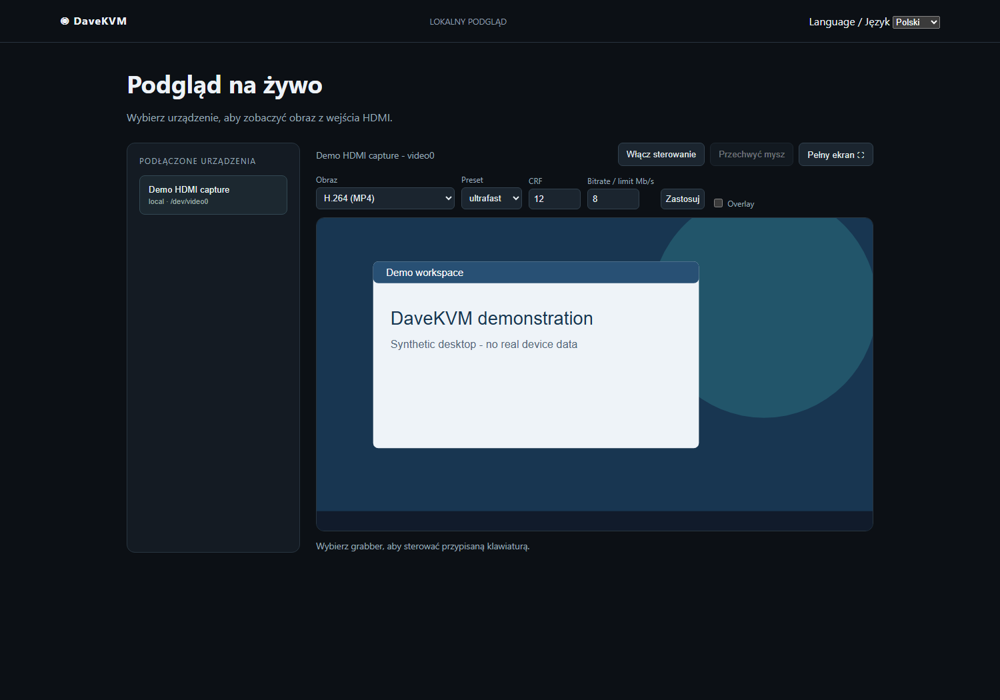
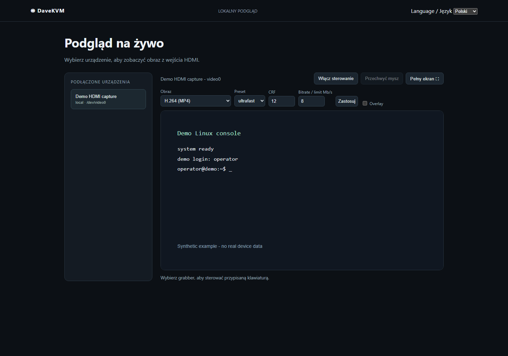

# DaveKVM

DaveKVM is a small, self-hosted browser interface for viewing an HDMI capture
device and controlling a connected computer through a CH9329 USB HID adapter.
It also provides command-line tools for screenshots, MJPEG streams and JSON
keyboard/mouse automation over an authenticated SSH session.



The screenshots use generated examples. They do not show a real computer.



## Features

- Shared V4L2 MJPEG capture, still images and streaming to multiple viewers.
- Browser playback as MJPEG or fragmented MP4 with software H.264; Intel Quick
  Sync H.264/H.265 is available when FFmpeg and the local driver support it.
- Browser keyboard and mouse with a short, exclusive lease per target. Control
  is released when the lease expires, the tab loses focus or the stream stops.
- JSON Lines keyboard and mouse control and a CLI for image capture.
- Optional, narrowly scoped SSH bridge for a capture device on another Linux host.
- Polish, English, German and Czech UI. The selection is stored in a cookie.

## Security first

The built-in server uses HTTP Basic authentication. **HTTP alone does not
encrypt the password, keyboard input or video.** By default DaveKVM listens
only on loopback. Connect with an SSH tunnel or put it behind a properly
configured HTTPS reverse proxy and restrict access to trusted users. Do not
expose the built-in HTTP server directly to the internet. There is currently
no built-in rate limiting or multi-user account management.

Each control mapping must point to the intended physical computer. Test it
with non-destructive input before using it. A disconnection or hardware failure
can prevent a release report from reaching the target. Some shortcuts are
intercepted by the local browser or operating system. Ctrl+Alt releases
pointer capture; the browser may also use Escape.

## Requirements

- Linux with Python 3.10+, FFmpeg with V4L2 support and `pyserial`.
- A UVC capture device that provides MJPEG and is accessible to the service
  account. Confirm the device's supported resolution before starting.
- For input: a CH340 USB-to-serial adapter connected to CH9329, configured at
  9600 baud, and permission to open its serial port. Confirm electrical levels,
  wiring and common ground from your hardware documentation. Do not connect
  power pins between systems without verifying the hardware design.
- For QSV: compatible Intel hardware, VA-API/QSV drivers and an FFmpeg build with
  the relevant encoders. Browser HEVC support varies. FFmpeg and its optional
  components have their own licenses.

## Local setup

Create a virtual environment and install the Python dependency:

```sh
python3 -m venv .venv
. .venv/bin/activate
pip install -r requirements.txt
```

Create a private password file once, without putting the password into shell
history or the repository. This command refuses to overwrite an existing file:

```sh
umask 077
mkdir -p ~/.config/davekvm
python3 -c 'import pathlib,secrets; p=pathlib.Path.home()/".config/davekvm/password"; p.open("x").write(secrets.token_urlsafe(32)+"\n")'
```

Identify your capture and serial devices and explicitly map the capture ID to
its own stable serial path. Replace the example path with the one you verified:

```sh
export DAVEKVM_SERIAL_MAP='{"video0":"/dev/serial/by-id/your-adapter"}'
python3 server.py
```

Visit `http://127.0.0.1:8080/grabber/` on that machine. The default username is
`davekvm`; the password is in the private file created above. Without a serial
mapping, video can still be viewed but the control button remains disabled.
For a remote workstation, use SSH local forwarding, for example:

```sh
ssh -L 8080:127.0.0.1:8080 your-ssh-alias
```

Then open the same loopback URL on the workstation. No special SSH key or
network address is supplied with DaveKVM.

## Configuration

All settings are optional except the password file. Set them in your service
environment; keep private values out of version control.

| Variable | Default | Purpose |
| --- | --- | --- |
| `DAVEKVM_PASSWORD_FILE` | `~/.config/davekvm/password` | UTF-8 password file, at least 16 characters |
| `DAVEKVM_USERNAME` | `davekvm` | Basic authentication username |
| `DAVEKVM_LISTEN` | `127.0.0.1` | Bind address |
| `DAVEKVM_PORT` | `8080` | Bind port |
| `DAVEKVM_ORIGIN` | `http://127.0.0.1:8080` | Exact public browser origin, including port if needed |
| `DAVEKVM_CAPTURE_SIZE` | `1280x720` | Local MJPEG input dimensions |
| `DAVEKVM_LOCAL_FPS` | `60` | Local capture rate, 1 to 120 fps |
| `DAVEKVM_REMOTE_FPS` | `30` | Remote capture rate used by the browser encoder |
| `DAVEKVM_SERIAL_MAP` | `{}` | JSON mapping capture IDs to serial paths or remote bridge targets |
| `DAVEKVM_REMOTE_SSH_ALIAS` | unset | Optional SSH host alias configured for the service user |
| `DAVEKVM_BASE_URL` | `http://127.0.0.1:8080` | CLI connection URL; set `DAVEKVM_ORIGIN` as well behind a proxy |

Set `DAVEKVM_ORIGIN` to the exact HTTPS origin when using a reverse proxy and
preserve the `Host` and `Origin` headers. The proxy must allow the `/grabber/`
routes and streaming responses without buffering. Terminate TLS at the proxy
and use a local loopback connection between proxy and DaveKVM. A non-loopback
HTTP bind is refused unless the operator explicitly sets
`DAVEKVM_ALLOW_INSECURE_REMOTE=1`; this does not provide encryption.

## CLI and optional SSH bridge

Run the tools on the host, or invoke them through an SSH session to it:

```sh
python3 davekvm-grabber list
python3 davekvm-grabber snapshot video0 > frame.jpg
python3 davekvm-control --device video0
```

The control tool emits a `ready` event and reads one JSON object per line.
For example, `{"action":"key","key":"Enter"}` presses and releases Enter;
`{"action":"type","text":"hello"}` types US-layout ASCII. It also accepts
`state`, `release`, `mouse` and `mouse_relative`; run `--help` for details.
Remote IDs have the form `remote-video0`.

To use the optional bridge, configure a dedicated SSH account and key on the
remote host with a forced command invoking `davekvm-bridge`. Disable forwarding,
PTY and shell access for that key. The forced-command wrapper must provide
`DAVEKVM_BRIDGE_SERIAL` with the verified serial path and may set
`DAVEKVM_BRIDGE_VIDEO_ID` (default `video0`). The server's service account
needs an SSH alias with strict host-key verification and its own key. Example:

```sh
export DAVEKVM_REMOTE_SSH_ALIAS='capture-host'
export DAVEKVM_SERIAL_MAP='{"remote-video0":"ssh:video0"}'
python3 server.py
```

The bridge accepts only list, stream and the configured keyboard command.
Its stream and control sessions have inactivity timeouts. Set
`DAVEKVM_BRIDGE_SIZE` and `DAVEKVM_BRIDGE_FPS` in the bridge's forced-command
environment when its defaults of 1920x1080 at 30 fps do not match the device.
Set `DAVEKVM_REMOTE_FPS` to the same frame rate on the server.

## Tests and development

On Linux with `pyserial` installed:

```sh
python3 -m unittest discover -s tests -p 'test_*.py'
node --test tests/*.js
```

The panel is standalone: `i18n.js` is embedded in `index.html` using
`python3 tools/embed_i18n.py index.html`. The screenshot generator
`tools/make_demo.py` creates synthetic HTML demo pages in a supplied existing
directory. Screenshots do not contact or display any real KVM device.

## License

Copyright (c) 2026 Dawid Bautsch. DaveKVM is distributed under the
[MIT License](LICENSE).
